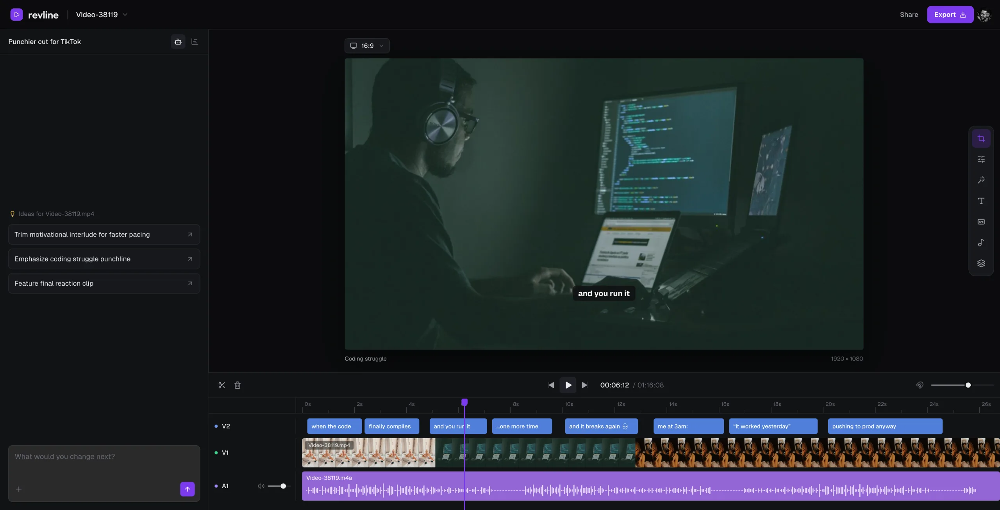

# Revline

[](LICENSE)

Revline is an open source, general-purpose agentic video editor. Ask the AI to turn your rough cut into a finished video, or create motion design for your startup in plain HTML + GSAP.

[tryrevline.com](https://tryrevline.com)



## What it does

- **Rough cut to finished video.** Cuts, speech cleanup, captions, b-roll, layers, transitions and effects on talking heads, vlogs, podcasts, reels and screen recordings.
- **Motion design in HTML + GSAP.** Launch films, feature films and teasers built from scratch as plain HTML + GSAP scenes on the same timeline.
- **Clipping.** Turns a long stream, VOD or podcast (or a Twitch, Kick or YouTube link) into separate 15–60 second shorts, with clipper-style captions and vertical layouts.
- **Remakes.** Recreates a video you share, or borrows one part of it (a transition, a title style, the pacing, the look) for your own edit.
- **A real timeline.** Every AI edit lands as tracks and clips you can open, adjust and undo in the browser.

## Use it from your coding agent

Using Claude Code, Codex, Cursor or another coding agent? Connect the Revline MCP server and your agent edits your projects through the same harness and tools as Revline's own agent.

MCP server URL:

```
https://tryrevline.com/mcp
```

Claude Code:

```sh
claude mcp add --transport http revline https://tryrevline.com/mcp
```

Then run `/mcp` in Claude Code to sign in. Or install the plugin, which adds the server and an editing skill:

```
/plugin marketplace add revlinehq/Revline
/plugin install revline@revline
```

Codex, Cursor, ChatGPT and any other MCP client connect to the same URL as a remote (HTTP) MCP server and sign in to Revline with OAuth. Connecting AI apps is included with Pro.

## Development

Requires Node.js 22. Copy [`.env.example`](.env.example) to `.env.local` and configure your own development services.

```sh
npm ci
npx convex dev
```

In another terminal:

```sh
npm run dev
```

`npm run dev` starts the frontend at http://localhost:3001 together with the development media worker. Before opening a pull request, run `npm run typecheck` and `npm run build`.

## Contributing

[Contributing](CONTRIBUTING.md) · [Security](SECURITY.md) · [Apache 2.0](LICENSE)
