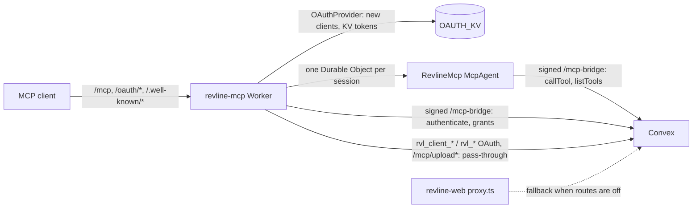

# MCP server on Cloudflare

`tryrevline.com/mcp`, `/oauth/*`, `/.well-known/oauth-*` and `/.well-known/openid-configuration` are served by the `revline-mcp-production` Worker (`cloudflare/mcp/`). Its routes take precedence over `revline-web`'s custom domain for those paths. Without them, `proxy.ts` in `revline-web` forwards the same paths to Convex's own MCP server (`convex/mcpHttp.ts`), which stays in place as the rollback.

- **Protocol.** `RevlineMcp` (Agents SDK `McpAgent`, MCP SDK v1 `Server`) holds one session per Durable Object: real streamable HTTP, including `GET` streams and resumption. Each session is bound to the connection that opened it. The tool catalog, instructions and resources are the same as Convex's (`lib/mcp/instructions.ts`, `lib/mcp/resources.ts`, `mcpActions:listTools`).
- **Tools.** Every call runs `mcpActions:callTool` in Convex through `/mcp-bridge` (`convex/mcpBridgeHttp.ts`). The call carries the client's credential, Convex authenticates it and derives the owner, the connection id (`<grantId>:<sessionId>`) and the agent identity exactly as the Convex server does. The Worker never names an owner. Bridge requests are HMAC-signed under `MCP_BRIDGE_SECRET` with single-use nonces (`convex/lib/runner_auth.ts`).
- **Auth.** New clients register with the Workers OAuth Provider (tokens in `OAUTH_KV`). The `/connect` consent page asks Convex for a signed approval (`mcpAuth:approveConsent`), posts it to the Worker, and Convex creates a `grant` row in `mcpTokens` whose key only the Worker holds. Every MCP request authenticates that key in Convex, so plan access, the 120 calls/minute limit, the profile's connection list and revocation work as before. A revoked connection fails on its next request and its next refresh.
- **Older connections.** Clients registered with Convex (`rvl_client_*`) and their tokens (`rvl_at_`, `rvl_rt_`, `rvl_pat_`) keep working unchanged. Their OAuth requests are forwarded to Convex's handlers, and their bearer tokens are checked by Convex on each request. Nobody has to reconnect.

Known limits: a client that revokes its own token through the provider (`/oauth/token` revocation) ends its tokens there, but its Convex grant row stays listed in the profile until it expires (60 days idle) or the user revokes it there; the key itself is never usable as a bearer token. Consent needs the app's `/connect` page and the Worker on the same site (the provider's consent cookie is `SameSite=Lax`): tryrevline.com in production, localhost:3001 with localhost:8787 locally. The deployed dev Worker on workers.dev therefore serves the protocol and older connections, but not a new OAuth connect from a local app.

## Settings to set (names only)

| Name | Where |
| --- | --- |
| `MCP_BRIDGE_SECRET` | Convex dev and prod environment variables (`npx convex env set`), and the matching Worker secret: `wrangler secret put MCP_BRIDGE_SECRET --config cloudflare/mcp/wrangler.jsonc` (dev) or `wrangler.production.jsonc` (prod). Use a different random value for each environment. |
| `NEXT_PUBLIC_MCP_ORIGIN` | Only for local or dev web builds whose consent page talks to a Worker on another origin, for example `http://localhost:8787`. Production leaves it unset (same origin). |
| `OAUTH_KV` | KV namespace binding. Wrangler creates it on the first deploy of each config. |

`MCP_PUBLIC_ORIGIN` (Convex, already set in production) must stay `https://tryrevline.com`: upload scripts and consent `iss` use it.

## Cutover

1. Deploy the Convex change to dev and set `MCP_BRIDGE_SECRET` there. Locally, run `npm run dev:mcp` with the app on localhost:3001 (`NEXT_PUBLIC_MCP_ORIGIN=http://localhost:8787`), then check initialize, tools/list, `listProjects` and one OAuth connect. Optionally run `npm run deploy:mcp` and connect with a personal token (`rvl_pat_…`) to `https://revline-mcp-dev.makaradze98-s.workers.dev/mcp`.
2. Set `MCP_BRIDGE_SECRET` on prod Convex and deploy Convex to prod. Existing clients still use Convex through `proxy.ts`.
3. Set the Worker secret and run `npm run deploy:mcp:production`. This attaches the five routes, so tryrevline.com MCP traffic switches to the Worker.
4. Check that the discovery documents, a connected client's tools/list and a tool call, and one new connection all work.

## Rollback

Remove the five `revline-mcp-production` routes (Cloudflare dashboard → Workers → revline-mcp-production → Domains & Routes, or redeploy without `routes`). Traffic falls back to `revline-web` → `proxy.ts` → Convex at once. Connections made through the Worker during cutover then need to reconnect; older connections are unaffected.

## Local

`npm run mcp:install`, then `npm run dev:mcp` (wrangler dev, dev Convex, `MCP_ORIGIN=http://localhost:8787`). Put `MCP_BRIDGE_SECRET` in `cloudflare/mcp/.dev.vars`, matching the target backend. `scripts/isolated-mcp.mjs` keeps talking to the worktree backend directly; set `REVLINE_MCP_URL=http://localhost:8787/mcp` to route it through the local Worker instead.
